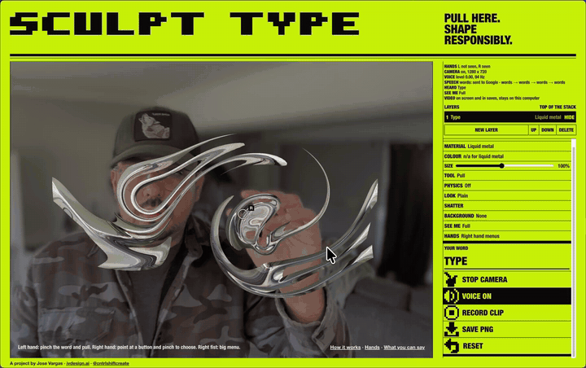

# Sculpt Type

Shape type with your hands and your voice, right in the browser. Pinch a letter and pull it like chrome, twist it, smear it, then talk to it: say a word and it becomes the word, say a colour and it changes.

**Try it:** **[jvargas718.github.io/sculpt-type](https://jvargas718.github.io/sculpt-type/)** (nothing to install)

[](https://jvargas718.github.io/sculpt-type/)

## How to use it

Open the link in a current desktop Chrome, press **Start camera**, and allow the camera. Turn on **Voice** and allow the mic if you want to talk to it.

| Do this | What happens |
|---|---|
| Pinch the word with your thumb and first finger, and pull | The letters stretch. Two hands stretch it from both ends. |
| Hold your right fist for half a second | Big tiles open next to your hand. Point at one with your right hand and pinch to choose. Fist again to close. |
| Hold your left fist | Resets the word. |
| Use the mouse | Drag the word, and use the panels on the right: font, material, colour, size, background, layers. |

### What you can say

| | Examples |
|---|---|
| The word | Say anything and it becomes the word. Start with "word" to force it: "word gold". |
| Material | "gold", "glass", "kraft board", "wax", or "next material" |
| Colour | "blue", "red", "lime", or "next colour" |
| Font | "font Anton", "font Shrikhand", or "next font" |
| Look | "mirror", "kaleidoscope", "trail", "print", "plain" |
| Tool | "pull", "twist", "smear", "poke", "magnet", "move" |
| Moves | "melt", "wobble", "set", "shatter", "explode", "bigger", "smaller", "reset" |
| Layers | "new layer", "next layer", "previous layer", "delete layer" |
| Save | "save" for a picture; "action" starts a clip, "cut" stops it |

Your voice also shapes it: louder makes the word bigger, a low voice squashes it, a high voice stretches it, a steady hum makes it ripple.

## Privacy

- Camera frames and mic levels are processed in your browser and are not uploaded.
- Speech-to-text uses your browser's built-in recognition. When the browser can't do it on your device, Chrome sends the audio to Google's speech service; the page asks before it uses that.
- Pictures you add as a background stay on your computer.

## Run it offline

Download the repository (**Code → Download ZIP**), unzip it, and serve the folder, for example:

```
python3 -m http.server 8000
```

Then open `http://localhost:8000`. Opening `index.html` straight from the file system can block the camera or speech in some browsers. The hand tracking model and fonts still load from the internet.

## Notes

- Best in a current desktop Chrome. Hand tracking needs a webcam and good light; voice needs a mic. Only one tab can use speech at a time.
- Built on [MediaPipe Hand Landmarker](https://ai.google.dev/edge/mediapipe/solutions/vision/hand_landmarker) (Apache 2.0) and [Google Fonts](https://fonts.google.com/) (open font licenses). Single file, no build step.

---

A project by Jose Vargas · [jvdesign.ai](https://jvdesign.ai) · [@cntrlshiftcreate](https://www.instagram.com/cntrlshiftcreate/)
